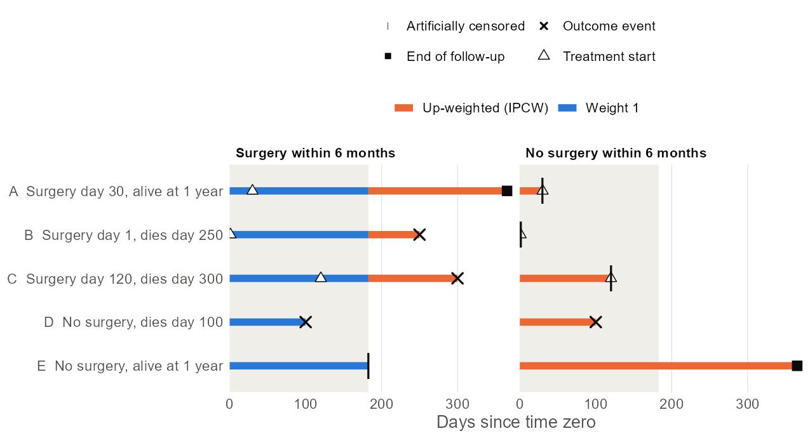
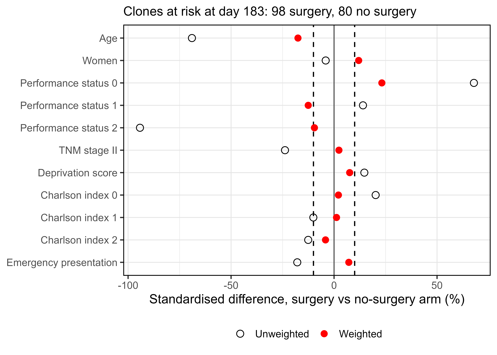
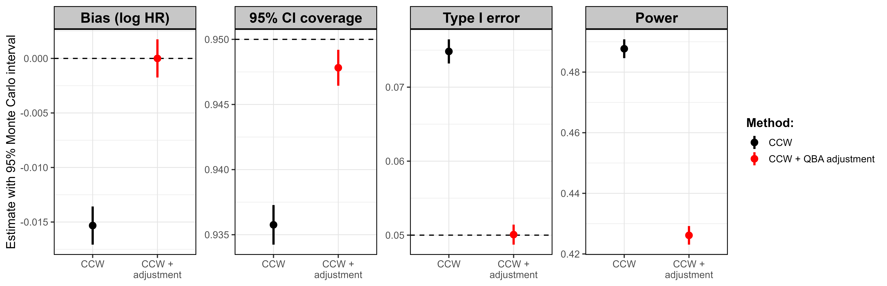
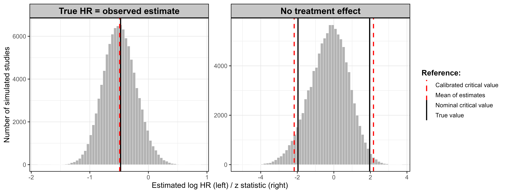
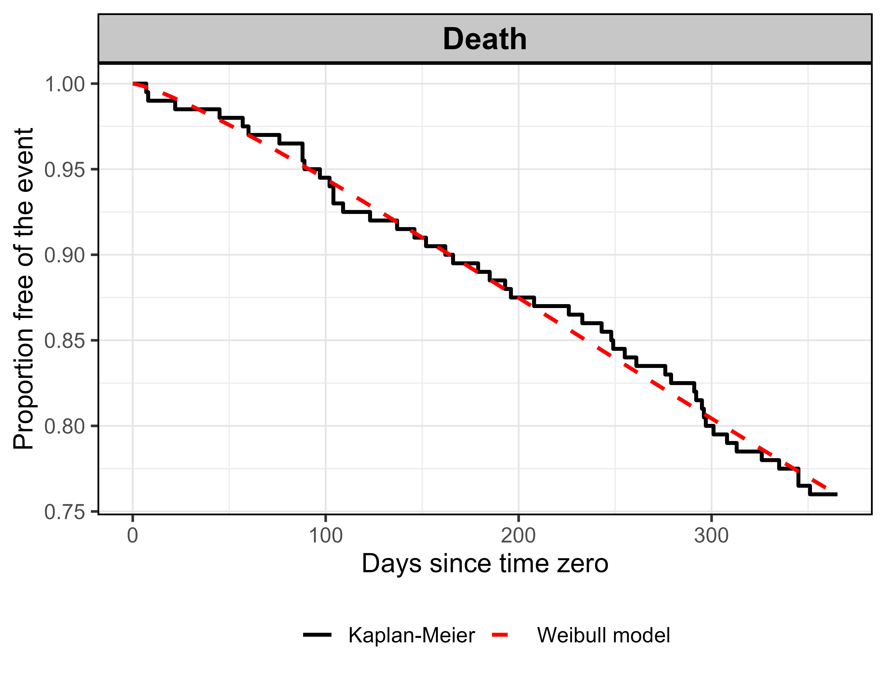

::: {.cell}

:::


::: {.callout-important appearance="simple"}
## Key answer

**The CCW analysis of the Maringe example carries a small but detectable modelling bias, its 95% CIs under-cover, and its type I error is inflated by about half. The QBA adjustments restore nominal coverage and type I error.** The true CCW effect was set to the observed estimate and the study was replayed 100,000 times on the original 200 patients; a second set of 100,000 replays checked the case of no surgery effect.

| | CCW as published | CCW + QBA adjustment |
|---|---|---|
| HR, surgery within 6 months vs not (95% CI) | 0.6206 (0.3691–1.0433), p = 0.072 | 0.6301 (0.3677–1.0800), calibrated p = 0.101 |
| Bias, log HR (MC 95% interval) | **-0.015** (-0.019 to -0.011) | 0 by construction |
| 95% CI coverage (target 95%) | **93.6%** | 94.8% |
| Type I error (target 5%) | **7.483%** | 5.007% |
| Power at the observed effect | 48.8% | 42.6% |

Monte Carlo SE: about 0.2–0.3 percentage points for coverage and type I error, 0.006 for the bias. Bold cells differ from the target by more than their Monte Carlo error. Adjusted performance is cross-fitted (corrections estimated on one half of the replays, checked on the other).

- **Bias:** the average estimate is HR 0.6127 instead of 0.6221, slightly too favourable to surgery (5% of one SE).
- **Coverage:** the robust SE is 3.6% too small, so the CIs cover the truth 93.6% of the time.
- **Type I error:** with no surgery effect, 7.483% of studies are significant, 6.267% of them in favour of surgery. Even with unlimited data the null CCW HR would be 0.9645.
- **Conclusion unchanged:** the observed result was not significant (p = 0.072) and is less so after adjustment (p = 0.101).
:::

**What changed since the 5 October report:** one dataset only (Maringe, as agreed for the paper); 100,000 instead of 5,000 replays per scenario; the censoring mechanism is addressed explicitly (Section 2.3); performance of the adjusted analysis is now evaluated, not only the adjusted estimate. The two-dataset report is kept in `archive/2026-10-05_two_datasets/`. Results agree with that run within Monte Carlo error.

# 1. What was done

The draft paper's steps, applied to the published CCW analysis of Maringe et al. (2020):

| Paper step | What it means here |
|---|---|
| 1. Fit the reference model | Run the CCW analysis on the original data (Section 1.1). |
| 2. Keep baseline data | All covariates **and each patient's actual surgery date** are kept unchanged. |
| 3. Predict outcomes | New death times from a Weibull model fitted to the data, in which surgery changes the hazard **from the day it takes place**. Surgery happens only if the patient is alive on that date. Censoring is predicted as well (Section 2.3). The surgery effect is calibrated so that the true CCW effect equals the observed estimate. |
| 4. Repeat | 100,000 replays per scenario; two scenarios: observed effect and no effect (200,000 CCW analyses; 2 failed). |
| 5. Re-analyse | The same CCW function as on the real data. |
| 6. Quantify | Bias, CI coverage, type I error and power, each with Monte Carlo SE. |
| 7. Adjust | Bias-corrected estimate, widened CI, calibrated critical value and p-value; their performance checked by cross-fitting. |

## 1.1 Data and analysis

The dataset is the simulated example distributed with Maringe et al. (2020; `ccwr::lungcancer`): 200 elderly patients with stage I–II lung cancer, followed from diagnosis for one year. 106 had surgery (42 on day 1) and 48 died. It is not the registry cohort of their Table S2, but the table below uses the same layout.


::: {.cell tbl-cap='Patient characteristics by surgery during follow-up.'}
::: {.cell-output-display}


|                                 | Received surgery N|         %| Did not receive surgery N|        % | SMD (%)|
|:--------------------------------|------------------:|---------:|-------------------------:|---------:|-------:|
|**Total**                        |                106|     100.0|                        94|     100.0|        |
|**Sex**                          |                   |          |                          |          |        |
|&emsp;Men                        |                 56|      52.8|                        51|      54.3|    -2.9|
|&emsp;Women                      |                 50|      47.2|                        43|      45.7|        |
|**Performance status**           |                   |          |                          |          |        |
|&emsp;0                          |                 46|      43.4|                        11|      11.7|    75.9|
|&emsp;1                          |                 54|      50.9|                        41|      43.6|    14.7|
|&emsp;2                          |                  6|       5.7|                        42|      44.7|  -100.7|
|**Charlson's comorbidity index** |                   |          |                          |          |        |
|&emsp;0                          |                 48|      45.3|                        34|      36.2|    18.6|
|&emsp;1                          |                 40|      37.7|                        39|      41.5|    -7.7|
|&emsp;2                          |                 18|      17.0|                        21|      22.3|   -13.5|
|**TNM stage**                    |                   |          |                          |          |        |
|&emsp;I                          |                 76|      71.7|                        53|      56.4|    32.3|
|&emsp;II                         |                 30|      28.3|                        41|      43.6|        |
|**Route to diagnosis**           |                   |          |                          |          |        |
|&emsp;Emergency                  |                 11|      10.4|                        20|      21.3|   -30.2|
|&emsp;Non-emergency              |                 95|      89.6|                        74|      78.7|        |
|                                 |             Median|     Q1 Q3|                    Median|     Q1 Q3|        |
|**Age at diagnosis (years)**     |               76.3| 73.0 79.9|                      81.2| 76.7 84.9|   -66.1|
|**Deprivation score**            |               0.15| 0.07 0.28|                      0.14| 0.07 0.26|    14.0|
|**Time to surgery (days)**       |                 25|      1 43|                          |          |        |


:::
:::


| Protocol element | Maringe et al. (2020) |
|---|---|
| Time zero | Cancer diagnosis |
| Strategies | Surgery within 6 months (182.62 days, arm 1) vs no surgery within 6 months (arm 0) |
| Outcome, follow-up | All-cause death; to death or 1 year (365.24 days) |
| Artificial censoring | Arm 0: on the day of surgery (if within 6 months). Arm 1: at 182.62 days if alive and not operated. Deaths before 6 months without surgery count in both arms. |
| Censoring weights | Arm 0: Cox model for time to surgery, weights updated at each surgery date. Arm 1: logistic model for surgery by 6 months among survivors. Both on age, sex, performance status, stage, deprivation, Charlson index, emergency presentation. |
| Outcome model | Weighted Cox, strategy only, Efron ties, robust (patient-clustered) SE |
| Loss to follow-up | None: every survivor is followed to 1 year |


::: {.cell}
::: {.cell-output-display}
{#fig-prot}
:::
:::


**Covariate balance at 6 months** (as Figure S2 of Maringe et al.). Among clones still at risk at the end of the grace period, the arms differ strongly before weighting; the censoring weights reduce, but do not remove, these differences.


::: {.cell}
::: {.cell-output-display}
{#fig-balance width=75%}
:::
:::


::: {.cell}

:::


Before weighting, 10 of 11 covariate terms differ by more than 10% (largest 94.2%); after weighting, 4 still do (performance status 0 23.2%, age -17.5%, performance status 1 -12.5%, sex 11.9%). In the registry data of Maringe et al. all weighted differences were within 10%; in this 200-patient example the weight models leave residual imbalance. This is consistent with the no-effect scenario, where the CCW estimate stays below HR = 1 even with unlimited data (Section 2.2).

## 1.2 Run time


::: {.cell tbl-cap='Computing time of the full pipeline by stage (sum over targets, all workers).'}
::: {.cell-output-display}


|Stage                                                | Minutes| Share|Units                                | Seconds per unit|
|:----------------------------------------------------|-------:|-----:|:------------------------------------|----------------:|
|Simulated studies (paper Steps 3–5)                  |   587.4|   83%|200,000 CCW analyses of 200 patients |            0.176|
|True values ψ(θ*) and ψ(0)                           |    92.2|   13%|192 large datasets of 50,000         |           28.814|
|Calibration of θ* (paper Step 3)                     |    25.5|    4%|48 large datasets of 50,000          |           31.882|
|Data, model fits, summaries, tables, figures, report |     5.1|    1%|                                     |                 |


:::
:::


::: {.cell}

:::


Computing time was 710.2 minutes; with 3 parallel workers (`crew` 1.3.3, 4 cores available, R version 4.6.1 (2026-06-24 ucrt)) the simulation stages took 268.7 minutes of elapsed time. The 200 batches of simulated studies and the two true values run in parallel; the calibration search is sequential because each step needs the previous one, so it sets the lower bound (25.5 minutes) however many workers are used. One CCW analysis of the 200 patients takes about 176 ms; the large datasets that define the true value take 17% of the computing time. Results do not depend on the number of workers: every replicate draws from its own seed.

# 2. How the simulation works {#methods}

## 2.1 Simulate patients, not the CCW

CCW is an analysis procedure (cloning, artificial censoring, censoring weights, weighted outcome model), not a model of how outcomes arise, so nothing can be drawn from it directly:

- The fitted CCW outcome model describes survival under two *strategies*: every patient appears in both arms, with one hazard ratio from day 0. A real patient has one history, and before surgery both strategies are identical for that patient.
- The cloned dataset is not data: clones, artificial censoring and weights are produced by the analysis. Redrawing outcomes on the clones with weights held fixed would test only a weighted Cox fit, not CCW.

So the outcome-generating model is a patient-level model fitted to the original data: Weibull survival with surgery as a time-varying exposure, h(t) = h₀(t)·exp(γ′X + θ·1{t ≥ surgery date}). Covariates and surgery dates are kept (paper Step 2) and new death times are drawn. Each simulated dataset looks like the original data, and the whole CCW procedure is re-run on it.

## 2.2 Why the truth is not θ, and calibration

θ is the effect of surgery *once received*, at fixed covariates. The CCW hazard ratio compares *strategies* and differs from θ because of grace-period dilution (in the surgery arm patients are untreated until their surgery date), non-proportional strategy hazards, and non-collapsibility (the CCW model contains the strategy only). None of these has a closed form, so the truth ψ(θ) is computed numerically: the base data are copied to 50,000 patients, outcomes are simulated and the same CCW function is run; this is repeated 96 times and averaged.

θ is then searched until ψ(θ) equals the observed CCW estimate (paper Step 3):


::: {.cell tbl-cap='Calibration path (secant search, 12 large datasets per step).'}
::: {.cell-output-display}


| Step| θ (log HR)| Weibull HR exp(θ)| ψ(θ), CCW log HR| CCW HR|
|----:|----------:|-----------------:|----------------:|------:|
|    1|     -0.415|            0.6605|           -0.307| 0.7359|
|    2|     -0.915|            0.4006|           -0.590| 0.5543|
|    3|     -0.716|            0.4889|           -0.484| 0.6165|
|    4|     -0.703|            0.4949|           -0.476| 0.6211|


:::
:::


Result: θ\* = -0.703 (Weibull HR 0.4949), against the fitted coefficient θ = -0.415 (HR 0.6605). With 96 large datasets the truth is ψ(θ\*) = -0.475 (HR 0.6221, MCSE 0.002), equal to the observed -0.477 within Monte Carlo error. The draft's sentence "θ = −0.70, which results in HR~CCW~ = 0.48" should read: θ\* = −0.70 (Weibull HR 0.4949), which results in HR~CCW~ = 0.6221.

**No-effect scenario (θ = 0).** Every patient's outcome is then identical under both strategies, so every estimand is exactly null and the truth needs no estimation. The large-sample value ψ(0) = -0.036 is computed only as a diagnostic: it shows that CCW is off-centre even with unlimited data.

## 2.3 Censoring (paper Section 2.3) {#censoring}

The paper says that for time-to-event data the censoring distribution is also predicted, by switching the event/censoring indicator and modelling censoring dependent on covariates, and that the final times are the minimum of event and censoring times. This includes censoring after treatment start.

**How the code does it.** `fit_dgm()` fits a second Weibull model with the indicator switched: loss to follow-up is the event, deaths and the end of follow-up are censored. It uses the same covariates and surgery as a time-varying term, so censoring after treatment start has its own hazard. `simulate_outcomes()` draws a censoring time for each patient by the same inversion as the event time, from its own random numbers, and sets follow-up to min(event, censoring, end of study). This is controlled by `censoring: model` in `config/config.yml` and covered by unit tests.

**Why it changes nothing for Maringe.** In the original data all 152 survivors are followed to day 365.24: nobody is lost to follow-up. With the indicator switched there are no censoring events, so a censoring model cannot be fitted, and the predicted censoring distribution is the observed one: administrative censoring at one year for every patient. Maringe therefore runs with `censoring: none`, and the simulated data have exactly the original censoring pattern. Artificial censoring of clones is not part of this step: it is produced by the CCW analysis itself in every replay.

**For the paper.** Section 4 should state that the example has administrative censoring only. Two places in the draft disagree with Section 2.3 and could be aligned: the step figure ("keep … censoring times fixed") and Table 1, row "Censoring" ("generated from a separately fitted censoring model"). For Maringe the two descriptions give the same simulated data, because the censoring model reduces to fixed administrative censoring.

# 3. Results


::: {.cell}
::: {.cell-output-display}
{#fig-perf width=100%}
:::
:::


**Bias.** The average estimate is HR 0.6127 against a truth of 0.6221: a bias of -0.015 on the log scale (MC 95% interval -0.019 to -0.011), away from the null, detectable but small (5.4% of one SE).

**Coverage.** The empirical SE is 0.282, the average robust SE 0.272 (3.6% too small). Together with the bias this gives coverage of 93.6% (MCSE 0.1%).

**Type I error.** With no surgery effect, 7.483% (MCSE 0.083%) of studies reject H0: HR = 1 at 5%; 6.267% in favour of surgery and only 1.216% against it. The null estimates are centred at HR 0.9510, of which 0.9645 would remain with unlimited data, most likely because the censoring-weight models do not fully capture how surgery decisions depend on patient characteristics.

**Power** to detect the observed effect is 48.8%, consistent with the observed CI that includes 1.


::: {.cell}
::: {.cell-output-display}
{#fig-dist width=100%}
:::
:::


# 4. Adjustment of the observed result (paper Step 7)


::: {.cell tbl-cap='Observed analysis, calibration and QBA adjustment.'}
::: {.cell-output-display}


|                                                                   |                     Value|
|:------------------------------------------------------------------|-------------------------:|
|Observed CCW HR (95% CI)                                           | 0.6206 (0.3691 to 1.0433)|
|Observed p-value                                                   |                     0.072|
|Weibull outcome model: on-treatment HR (exp(theta-hat))            |                    0.6605|
|Calibrated generating HR, exp(theta*)                              |                    0.4949|
|True CCW HR in the simulated world, exp(psi(theta*)) (MCSE of psi) |            0.6221 (0.002)|
|Large-sample CCW HR with no treatment effect, exp(psi(0))          |                    0.9645|
|QBA-adjusted HR (95% CI)                                           | 0.6301 (0.3677 to 1.0800)|
|CI inflation factor (empirical / model SE)                         |                      1.04|
|Calibrated critical value &#124;z&#124; for a 5% test              |                      2.17|
|Simulation-calibrated p-value                                      |                     0.101|


:::
:::


- **Estimate:** observed − bias, the paper's grid search to first order.
- **CI:** widened by empirical SE / model SE = 1.04.
- **Test:** a 5% test needs |z| > 2.17 instead of 1.96; the calibrated p-value is the share of no-effect replays with |z| at least as large as observed.

**Does the adjusted analysis work?** Applying the adjustments estimated from half of the replays to the other half: coverage 94.8% (MCSE 0.1%), type I error 5.007% (MCSE 0.069%). Both are back at their targets. The price is lower power (42.6% instead of 48.8%), because part of the original power came from the inflated type I error.


::: {.cell tbl-cap='Performance before and after QBA adjustment (estimate (MCSE)).'}
::: {.cell-output-display}


|Performance measure                         | CCW as published| CCW + QBA adjustment|
|:-------------------------------------------|----------------:|--------------------:|
|Mean estimate, log HR (true value)          |  -0.490 (-0.475)|                     |
|Bias, log HR                                |   -0.015 (0.002)|  0 (by construction)|
|Relative bias, % of empirical SE            |             -5.4|                     |
|Empirical SE                                |    0.282 (0.001)|                     |
|Model-based (robust) SE                     |            0.272|                     |
|Relative error in model SE, %               |             -3.6|                     |
|RMSE                                        |            0.282|                     |
|95% CI coverage, %                          |       93.6 (0.1)|           94.8 (0.1)|
|Power, % (true HR = observed)               |       48.8 (0.2)|           42.6 (0.2)|
|Type I error, % (no effect)                 |    7.483 (0.083)|        5.007 (0.069)|
|Rejections favouring surgery, % (no effect) |            6.267|                     |
|Failed replicates, n                        |                2|                     |


:::
:::


# 5. Alignment with the draft paper (version 0.62, 8 Oct) {#alignment}

| Draft paper | This run |
|---|---|
| Section 2.3: censoring predicted by switching the event/censoring indicator | **Implemented**; for Maringe it reduces to administrative censoring at 1 year (Section 2.3 above). Step figure and Table 1 "Censoring" row to be aligned. |
| Section 4.2: covariates age, sex, performance status, stage, deprivation, Charlson, emergency | **As used** in both the weight models and the Weibull model. |
| Section 4.3: "θ = −0.70, which results in HR~CCW~ = 0.48" | θ\* = -0.70 is confirmed; HR~CCW~ = 0.6221 (= observed), exp(θ\*) = 0.4949. |
| Discussion: "small but detectable bias … type I error rate (7.1%) and 95% CI coverage (93.7%)" | Bias confirmed (-0.015); coverage **93.6%**; type I error **7.483%**, not 7.1%. |
| Discussion: "QBA-based adjustments successfully restored unbiasedness, the nominal type I error rate, and nominal 95% CI coverage" | **Confirmed** by cross-fitting: coverage 94.8%, type I error 5.007%. |
| Section 4 placeholder: "Report also running time on how many cores" | 268.7 minutes elapsed with 3 workers (710.2 minutes of computing time; Section 1.2). |
| ISPE 2026 remark (Wang, Zivich et al.): CCW may have low CI coverage | **Supported:** 93.6%. |

# 6. Caveats and next steps

- Truths are simulated (MCSE 0.002); this is included in the bias interval.
- Adjusted bias is zero by construction under two-fold cross-fitting; coverage and type I error of the adjusted analysis are genuine checks.
- The null offset (ψ(0) ≠ 0) suggests the censoring-weight models are not flexible enough; a sensitivity analysis with splines for age and deprivation in the weight models would test this.
- The Word draft of paper Section 4 (`reports/paper/section4_draft.docx`) uses the same results.

# Appendix

## A1. Performance in both scenarios


::: {.cell}
::: {.cell-output-display}


|Scenario        | θ (DGM)| True HR| Mean HR| Bias (log HR)|  MCSE| Emp. SE| Model SE| Coverage| Reject HR = 1| Mean deaths| Failed|
|:---------------|-------:|-------:|-------:|-------------:|-----:|-------:|--------:|--------:|-------------:|-----------:|------:|
|Observed effect |   -0.70|  0.6221|  0.6127|        -0.015| 0.002|   0.282|    0.272|    93.6%|       48.770%|        44.4|      1|
|No effect       |    0.00|  1.0000|  0.9510|        -0.050| 0.001|   0.274|    0.267|    92.5%|        7.483%|        55.0|      1|


:::
:::


Measures were cross-checked with `rsimsum` (identical bias, empirical SE, coverage and rejection rate).

## A2. Data-generating mechanism

**Kept fixed from the original data (paper Step 2):** covariates $X_i$ and each patient's surgery date $s_i$ ($s_i = \infty$ if not operated). **Censoring:** $C_i = 365.24$ for all patients (no loss to follow-up; Section 2.3).

**Outcome model.** Weibull proportional hazards with surgery as a time-varying exposure:

$$h_i(t) = \lambda \rho\, t^{\rho - 1} \exp\{\gamma^\top X_i + \theta\, I(t \ge s_i)\}, \qquad \eta_i = \log\lambda + \gamma^\top X_i,$$

$$H_i(t) = e^{\eta_i}\left[\min(t, s_i)^{\rho} + e^{\theta}\,\max\{0,\; t^{\rho} - s_i^{\rho}\}\right].$$

Fitted by maximum likelihood, $\ell = \sum_i \left[\delta_i \log h_i(Y_i) - H_i(Y_i)\right]$ (Table A2). In simulation, $\log\lambda$, $\rho$ and $\gamma$ are kept at their fitted values and $\theta$ is set to the scenario value ($\theta^*$ or 0). Where a censoring model is fitted, it has the same form with the indicator switched ($1 - \delta_i$ for loss to follow-up).

**Simulation by inversion** (common random numbers: $U_i$ depends only on the replicate seed, not on $\theta$). With $E_i = -\log U_i$:

$$T_i = \begin{cases} \left(E_i\, e^{-\eta_i}\right)^{1/\rho} & \text{if } E_i \le e^{\eta_i} s_i^{\rho} \text{ (death before surgery)},\\[4pt] \left\{ s_i^{\rho} + \left(E_i - e^{\eta_i} s_i^{\rho}\right) e^{-\eta_i - \theta} \right\}^{1/\rho} & \text{otherwise.} \end{cases}$$

**Observed data:** $Y_i = \min(T_i, C_i)$, $\delta_i = I(T_i \le C_i)$; surgery is observed at $s_i$ only if $s_i \le Y_i$.


::: {.cell tbl-cap='Fitted Weibull model for death (hazard ratios).'}
::: {.cell-output-display}


|Term                        |     HR|           95% CI|
|:---------------------------|------:|----------------:|
|Weibull shape (rho)         |   1.29|                 |
|Age (per 5 years)           | 0.9328| 0.7102 to 1.2253|
|Female                      | 0.4992| 0.2678 to 0.9304|
|Performance status 1 vs 0   | 1.0329| 0.4419 to 2.4143|
|Performance status 2 vs 0   | 2.4222| 0.9315 to 6.2985|
|TNM stage II vs I           | 1.5921| 0.8822 to 2.8731|
|Deprivation score (per 0.1) | 0.9563| 0.7516 to 1.2168|
|Charlson index 1 vs 0       | 0.8601| 0.4318 to 1.7132|
|Charlson index 2 vs 0       | 1.0832| 0.5035 to 2.3299|
|Emergency presentation      | 1.1949| 0.5690 to 2.5090|
|On treatment (time-varying) | 0.6605| 0.3189 to 1.3684|


:::
:::


::: {.cell}
::: {.cell-output-display}
{#fig-fit width=60%}
:::
:::


::: {.cell}

```{.r .cell-code  code-fold="true" code-summary="R code: Weibull fit, censoring model and simulation (R/dgm.R)"}
#' Fit the reference DGM (outcome and censoring models) to the base data
#' @param data Base data from `prepare_base_data()`.
#' @param spec `cfg$dgm`; @param cens_spec `cfg$censoring` (model: none, fixed or weibull).
#' @return Outcome-model list (see `fit_weibull_tv()`) with element `cens`.
fit_dgm <- function(data, spec, cens_spec = list(model = "fixed")) {
  checkmate::assert_data_table(data)
  checkmate::assert_choice(cens_spec$model, c("none", "fixed", "weibull"))
  dgm <- fit_weibull_tv(data, spec$covariates, data$status)
  # Censoring model: loss to follow-up is the event; outcome events and the horizon censor it
  dgm$cens <- if (cens_spec$model == "weibull") {
    c(list(model = "weibull"), fit_weibull_tv(data, cens_spec$covariates, data$cens_event))
  } else {
    list(model = cens_spec$model)
  }
  dgm
}

#' Invert the piecewise Weibull cumulative hazard (switch to exp(theta) at time s)
#' @param eta Linear predictor incl. intercept; @param rho Shape; @param theta Log-HR on treatment.
#' @param s Planned treatment time; @param u Uniforms.
#' @return Simulated times; the same u gives times monotone in theta.
invert_weibull_tv <- function(eta, rho, theta, s, u) {
  E <- -log(u)
  h_pre <- exp(eta) * s^rho
  data.table::fifelse(
    E <= h_pre,
    (E / exp(eta))^(1 / rho),
    (s^rho + (E - h_pre) / exp(eta + theta))^(1 / rho)
  )
}

#' Simulate event (and censoring) times for fixed baseline data and treatment plans
#' @param data Base data (covariates and planned treatment time `s` are kept).
#' @param dgm Fitted DGM from `fit_dgm()`.
#' @param theta Treatment log-HR used for simulation.
#' @param u,u_cens Uniforms for event and censoring times, one per patient (CRN).
#' @return Copy of `data` with simulated `time`, `status`, `cens_time`, `trt_time`.
simulate_outcomes <- function(data, dgm, theta, u, u_cens = NULL) {
  checkmate::assert_numeric(u, len = nrow(data), lower = 0, upper = 1)
  X <- dgm_design(data, dgm$covariates)
  t_ev <- invert_weibull_tv(dgm$alpha + drop(X %*% dgm$gamma), dgm$rho, theta, data$s, u)
  out <- data.table::copy(data)
  cm <- if (is.null(dgm$cens)) "fixed" else dgm$cens$model
  if (cm == "weibull") {
    checkmate::assert_numeric(u_cens, len = nrow(data), lower = 0, upper = 1)
    cs <- dgm$cens
    Xc <- dgm_design(data, cs$covariates)
    # Censoring hazard also changes at treatment start; theta_c is kept as fitted
    eta_c <- cs$alpha + drop(Xc %*% cs$gamma)
    t_c <- invert_weibull_tv(eta_c, cs$rho, cs$theta_hat, data$s, u_cens)
    out[, cens_time := pmin(t_c, admin_time)]
  }
  out[, `:=`(time = pmin(t_ev, cens_time), status = as.integer(t_ev <= cens_time))]
  out[, trt_time := data.table::fifelse(s <= time, s, Inf)]
  out[]
}
```
:::


## A3. Censoring weights and outcome model

Grace period $g = 182.62$ days; $Z$ = age, sex, performance status, stage, deprivation, Charlson index, emergency presentation.

- *Arm 0, no surgery within $g$.* Censored at surgery: $C^a_i = s_i$ if $s_i \le \min(g, Y_i)$. Cox model for time to surgery with Breslow baseline; weights updated at every distinct surgery date:
$$W_i(t) = \frac{1}{\hat S^c(t \mid Z_i)} = \exp\left\{\hat\Lambda^c_0\big(\min(t, g)\big)\, e^{\hat\beta^\top Z_i}\right\}.$$
- *Arm 1, surgery within $g$.* Censored at $g$ if alive and not operated. Logistic model among patients alive at $g$, $\pi(Z) = P(s \le g \mid Z, Y > g)$:
$$W_i(t) = 1 \text{ for } t < g, \qquad W_i(t) = 1/\hat\pi(Z_i) \text{ for } t \ge g.$$
- *Outcome model.* Weighted Cox model on the stacked clones, $\lambda(t \mid A) = \lambda_0(t)\, e^{\psi A}$, Efron ties, robust SE clustered on patient, Wald 95% CI.


::: {.cell}

```{.r .cell-code  code-fold="true" code-summary="R code: cloning, weights and outcome model (R/pipeline.R)"}
#' Clone into "surgery within grace" (arm 1) and "no surgery within grace" (arm 0)
#' @param data Patient-level data; @param grace Grace period (days).
#' @return Clone rows: arm, end, event, art_cens.
build_clones <- function(data, grace) {
  ctrl <- data.table::copy(data)[, arm := 0L]
  ctrl[, art_cens := as.integer(trt_time <= grace)]
  ctrl[, `:=`(
    end = data.table::fifelse(art_cens == 1L, trt_time, time),
    event = data.table::fifelse(art_cens == 1L, 0L, status)
  )]
  surg <- data.table::copy(data)[, arm := 1L]
  # Deaths before grace without surgery stay in the surgery arm (Maringe et al. 2020)
  surg[, art_cens := as.integer(trt_time > grace & time > grace)]
  surg[, `:=`(
    end = data.table::fifelse(art_cens == 1L, grace, time),
    event = data.table::fifelse(art_cens == 1L, 0L, status)
  )]
  data.table::rbindlist(list(ctrl, surg))
}

#' Inverse probability of censoring weights for the control arm (Cox censoring model)
#' @param clones Control-arm clones; @param spec Pipeline spec.
#' @return Long data split at censoring times, with weight `w` = 1 / P(uncensored at start).
weight_control <- function(clones, spec) {
  f <- stats::reformulate(spec$cens_covariates, response = "survival::Surv(end, art_cens)")
  fit <- survival::coxph(f, data = clones, ties = "breslow")
  bh <- survival::basehaz(fit, centered = FALSE)
  clones[, lp := stats::predict(fit, type = "lp", reference = "zero")]
  # Split at the observed censoring (surgery) times: weights change only there
  ctimes <- sort(unique(clones[art_cens == 1L, end]))
  brk <- unique(c(0, ctimes[ctimes < spec$grace], spec$grace))
  long <- split_clones(clones, brk)
  H0 <- stats::stepfun(bh$time, c(0, bh$hazard))
  # Right-continuous: those censored at a break have left the risk set
  long[, w := exp(H0(pmin(start, spec$grace)) * exp(lp))]
  long[]
}

#' Inverse probability of censoring weights for the surgery arm
#' @param clones Surgery-arm clones; @param data Patient data; @param spec Pipeline spec.
#' @return Long data split at grace, with weight `w`.
weight_surgery <- function(clones, data, spec) {
  long <- split_clones(clones, c(0, spec$grace))
  # Censoring happens only at grace end, for patients alive and not yet operated
  alive <- data[time > spec$grace]
  alive[, op := as.integer(trt_time <= spec$grace)]
  f <- stats::reformulate(spec$cens_covariates, response = "op")
  fit <- stats::glm(f, family = stats::binomial(), data = alive)
  alive[, p_op := stats::predict(fit, type = "response")]
  long[, w := 1]
  long[alive, on = "id", p_op := i.p_op]
  long[start >= spec$grace, w := 1 / p_op]
  long[]
}

#' Weighted Cox model for the strategy contrast
#' @param long Stacked long data (id, arm, start, stop, ev, w); @param spec Pipeline spec.
#' @param robust Robust (cluster) SE; FALSE only for large-sample truth runs.
#' @return One-row data.table in the pipeline contract format.
fit_outcome <- function(long, spec, robust) {
  fit <- if (robust) {
    survival::coxph(
      survival::Surv(start, stop, ev) ~ arm,
      data = long, weights = w, cluster = id, ties = "efron"
    )
  } else {
    survival::coxph(survival::Surv(start, stop, ev) ~ arm, data = long, weights = w, ties = "efron")
  }
  est <- unname(stats::coef(fit)["arm"])
  se <- unname(sqrt(stats::vcov(fit)["arm", "arm"]))
  z <- stats::qnorm(1 - (1 - spec$conf_level) / 2)
  data.table::data.table(
    estimate = est, se = se, ci_lo = est - z * se, ci_hi = est + z * se,
    p_value = 2 * stats::pnorm(-abs(est / se)), n_events = sum(long$ev),
    status = "ok", message = NA_character_
  )
}
```
:::


## A4. True value, calibration, performance and adjustment

- **Truth:** $\tilde\psi(\theta) = \frac{1}{R}\sum_{r=1}^{R} \hat\psi^{(r)}_N$, with $N = 50,000$ and $R = 96$.
- **Calibration:** $\theta^*$ solves $\tilde\psi(\theta) = \hat\psi_{\text{obs}}$ (secant search from $\hat\theta$, 12 large datasets per step, tolerance 0.005).
- **Performance** over $B = 100,000$ replicates: bias $= \bar{\hat\psi} - \psi$; coverage $= B^{-1}\sum_b I(|\hat\psi_b - \psi| \le 1.96\,\widehat{SE}_b)$; rejection rate $= B^{-1}\sum_b I(|\hat\psi_b| > 1.96\,\widehat{SE}_b)$. The MCSE of the bias includes the truth's MC error.
- **Adjustment:** $\hat\psi^{adj} = \hat\psi - \widehat{\text{bias}}$; CI $\hat\psi^{adj} \pm 1.96\, k\, \widehat{SE}$ with $k = \max(1, SE_{emp}/SE_{mod})$; critical value $z^*$ = 95th percentile of $|z|$ under $\theta = 0$. Two-fold cross-fitting over replicate index for the adjusted performance.


::: {.cell}

```{.r .cell-code  code-fold="true" code-summary="R code: truth and calibration (R/truth.R)"}
#' Large-sample truth at one theta
#' @param dgm Fitted DGM; @param data Base data; @param theta Treatment log-HR in the DGM.
#' @param pipeline Pipeline spec; @param cfg Full config (uses `truth`, `seed_truth`).
#' @param n_rep Number of large datasets to average.
#' @return One-row data.table: theta, truth, truth_mcse, n_truth, n_rep.
compute_truth <- function(dgm, data, theta, pipeline, cfg, n_rep = cfg$truth$n_rep) {
  checkmate::assert_number(theta)
  big <- stack_copies(data, ceiling(cfg$truth$n_target / nrow(data)))
  # Same seeds at every theta (CRN), so psi(theta) is smooth for calibration
  seeds <- make_crn_seeds(cfg$seed_truth, n_rep)
  est <- vapply(seeds, function(sd) {
    rng <- draw_replicate_rng(sd, nrow(big))
    sim <- simulate_outcomes(big, dgm, theta, rng$u_event, rng$u_cens)
    run_pipeline(sim, pipeline, robust = FALSE)$estimate
  }, numeric(1))
  data.table::data.table(
    theta = theta,
    truth = mean(est),
    truth_mcse = if (n_rep > 1) stats::sd(est) / sqrt(n_rep) else NA_real_,
    n_truth = nrow(big),
    n_rep = n_rep
  )
}

#' Find theta* whose CCW truth equals the observed CCW estimate (paper Step 3)
#' @param dgm Fitted DGM; @param data Base data; @param obs_result Observed pipeline result.
#' @param pipeline Pipeline spec; @param cfg Full config (uses `calibration`).
#' @return List: theta_star, psi_star (search precision), path (search history).
calibrate_theta <- function(dgm, data, obs_result, pipeline, cfg) {
  cc <- cfg$calibration
  psi <- function(th) compute_truth(dgm, data, th, pipeline, cfg, n_rep = cc$n_rep)$truth
  target <- obs_result$estimate
  # Secant search started at the fitted coefficient; psi is smooth and monotone under CRN
  th <- c(dgm$theta_hat, dgm$theta_hat - 0.5)
  ps <- vapply(th, psi, numeric(1))
  for (i in seq_len(cc$max_iter)) {
    if (abs(ps[length(ps)] - target) < cc$tol) break
    n <- length(th)
    slope <- (ps[n] - ps[n - 1]) / (th[n] - th[n - 1])
    th_new <- th[n] + (target - ps[n]) / slope
    th_new <- max(-cc$bound, min(cc$bound, th_new))
    th <- c(th, th_new)
    ps <- c(ps, psi(th_new))
  }
  best <- which.min(abs(ps - target))
  list(
    theta_star = th[best],
    psi_star = ps[best],
    at_bound = abs(th[best]) >= cc$bound,
    path = data.table::data.table(step = seq_along(th), theta = th, psi = ps)
  )
}
```
:::


## A5. Settings and software

Common random numbers across scenarios; seeds and all settings in `config/config.yml`; design in `protocol/ADEMP.md`; pipeline structure in `docs/technical_setup.html`. Run time: Section 1.2.

R version 4.6.1 (2026-06-24 ucrt); crew 1.3.3, data.table 1.18.6.1, survival 3.8-12, targets 1.12.0.

